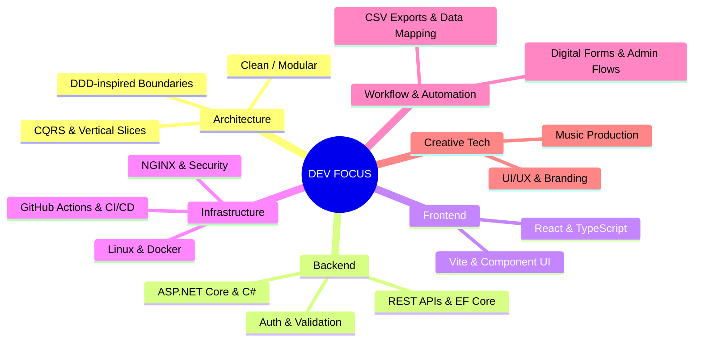

<!-- Original GitHub profile README by wizard-nazim | github.com/wizard-nazim -->
<table border=2" align="center">
  <tr>
    <td width="400" align="center" valign="top">
      

      https://desclution.vercel.app/
      

<td>

</td>
  </td>
  
  </tr>
</table>
<table border="0" align="left">
  <tr>
    <td width="70" align="center" valign="top">
      

        
      

    </td>
  </tr>
</table>
 

<table border="0" align="center">
  <tr>
    <td width="260" align="center" valign="top">
       
      
        
      <strong>wizard-nazim</strong> 
      <code>full-stack dev</code>
        
      
      &nbsp;
      
      &nbsp;
      
        
    </td>
    <td width="440" align="left" valign="top">
       

<pre><code>curious about:
> System Architecture & Clean Boundaries
> Backend APIs & Domain-Driven Design
> Infrastructure & Linux Homelab
> Security & Networking Tools
> Creative Tech — DAWs, UX/UI, Branding</code></pre>
 

  

      

    </td>
  </tr>
</table>

<table border="1" align="right">
  <tr>
    <td width="70" align="center" valign="top">
      

        
      

    </td>
    <td width="70" align="left" valign="top">
      

        
      

    </td>
  </tr>
</table>
      

        
      

      
<!-- ═══════════════════ NOW PLAYING ═══════════════════ -->

 
<table border="0" align="center">
    <td width="700" align="center" valign="top">
      <pre><code>currently listening to:</code></pre>

  

    </td>

<!-- ═══════════════════ CONTRIBUTION SNAKE ═══════════════════ -->
  <td width="700" align="center" valign="top">
      <pre><code>contribution snake:</code></pre>
      <picture>
        <source
          media="(prefers-color-scheme: dark)"
          srcset="https://raw.githubusercontent.com/wizard-nazim/wizard-nazim/output/wizard-nazim-snake-dark.svg"
        />
        <source
          media="(prefers-color-scheme: light)"
          srcset="https://raw.githubusercontent.com/wizard-nazim/wizard-nazim/output/wizard-nazim-snake.svg"
        />
        
      </picture>
    </td>
  </tr>
</table>

<table border="2" align="center">
    <td width="700" align="center" valign="top">
      <pre><code>daily driver:</code></pre>

 
</td>
 <td width="700" align="center" valign="top">
      <pre><code>other:</code></pre>
      
 </td>
</table>

 

 
  <pre>"Peace be upon you"</pre>
  

 

<table border="2" align="center">
   <td width="700" align="center" valign="top">
      <pre><code>frontend:</code></pre>
 </td>
 
    <td width="700" align="center" valign="top">
      <pre><code>infrastructure:</code></pre>

 
</td>
 <td width="700" align="center" valign="top">
      <pre><code>backend & database:</code></pre>
      
 </td>
</table>

<table border="0" align="left">
  <tr>
    <td width="70" align="center" valign="top">
      

        
      

    </td>
  </tr>
</table>
 

<!-- ═══════════════════ TECH MINDMAP ═══════════════════ -->

 

<!-- ═══════════════════ FOOTER ═══════════════════ -->

  <pre style="color: #67e8f9; font-size: 11px; margin: 0; letter-spacing: 1px; line-height: 1.5;"><code>@@@@@@@@@@@@@@@@@@@@@@@@@@@@@@@@@@@@@@@@@@@@@@@@@@@@@
@  designed by wizard-nazim • github.com/wizard-nazim  @
@@@@@@@@@@@@@@@@@@@@@@@@@@@@@@@@@@@@@@@@@@@@@@@@@@@@@</code></pre>

 

<!-- ═══════════════════ SILLY GIFS ═══════════════════ -->
<table border="0" align="left">
  <tr>
    <td width="70" align="center" valign="top">
      

        
      

    </td>
  </tr>
</table>

<table border="0" align="right">
  <tr>
    <td width="70" align="center" valign="top">
      

        
      

    </td>
  </tr>
</table>
      

       
      

<!--

  <tr>
  
  </tr>

 
-->

