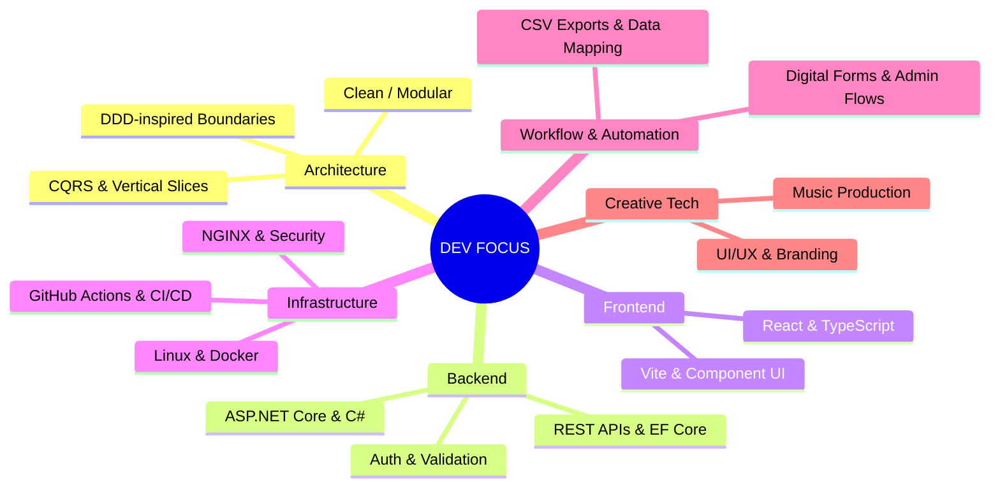

<table border="1" align="center">
  <tr>
    <td width="590" align="center" valign="top">
       
      
       
      <strong>wizard-nazim</strong>
       
      <code>full-stack dev</code>
        
      
      &nbsp;
      
      &nbsp;
      
        
      
    <td width="140" align="left" valign="top">
       
       
<pre><code>curious about:
> System Architecture & Clean Boundaries
> Backend APIs & Domain-Driven Design
> Infrastructure & Linux Homelab
> Security & Networking Tools
> Creative Tech — DAWs, UX/UI, Branding</code></pre>
        

  

    </td>
    <td width="240" align="left" valign="top">
       

 
<pre><code>engineering habits:
> Build, lint & test checks on every push
> GitHub Actions automation & CI before merge
> Docs, diagrams & architecture notes
> Projects fail loudly before production</code></pre>
 

      

    </td>
  </tr>
</table>

<!-- ═══════════════════ FOOTER ═══════════════════ -->

  <pre style="color: #67e8f9; font-size: 11px; margin: 0; letter-spacing: 1px; line-height: 1.5;"><code>@@@@@@@@@@@@@@@@@@@@@@@@@@@@@@@@@@@@@@@@@@@@@@@@@@@@@
@  designed by wizard-nazim •  https://desclution.vercel.app/  @
@@@@@@@@@@@@@@@@@@@@@@@@@@@@@@@@@@@@@@@@@@@@@@@@@@@@@</code></pre>

  <picture>
    <source media="(prefers-color-scheme: dark)" srcset="https://raw.githubusercontent.com/wizard-nazim/wizard-nazim/output/wizard-nazim-snake-dark.svg" />
    <source media="(prefers-color-scheme: light)" srcset="https://raw.githubusercontent.com/wizard-nazim/wizard-nazim/output/wizard-nazim-snake.svg" />
    
  </picture>
   
  Powered by commits, caffeine, and suspiciously long architecture discussions.

 

<!-- ═══════════════════ TECH MINDMAP ═══════════════════ -->

 

 

<!-- ═══════════════════ SILLY GIFS ═══════════════════ -->
<table border="0" align="left">
  <tr>
    <td width="70" align="center" valign="top">
      

        
      

    </td>
  </tr>
</table>

<table border="0" align="right">
  <tr>
    <td width="70" align="center" valign="top">
      

        
      

    </td>
  </tr>
</table>

<!--

  <tr>
  
  </tr>

 
-->
